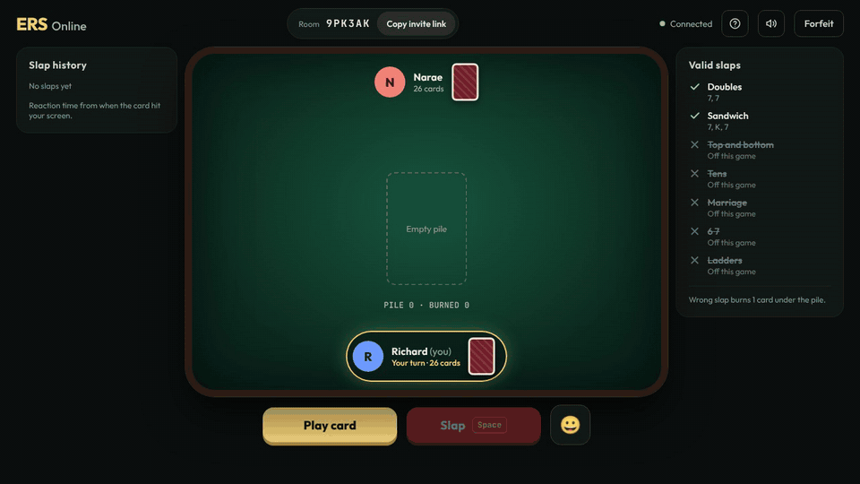
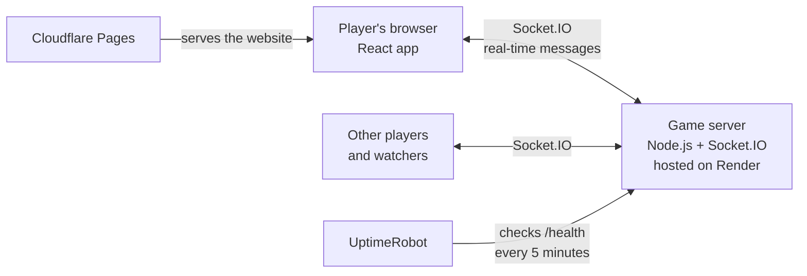

# ERS Online

**Egyptian Rat Screw, the fast card-slapping game, playable online with friends.**
Make a table, send the link, and slap.

**Play it:** [ers-online.pages.dev](https://ers-online.pages.dev)



---

## What it is

Egyptian Rat Screw (ERS) is a card game where players take turns flipping cards onto a pile and race to slap it when a pattern appears. The fastest correct slap wins the whole pile, and a wrong slap costs you a card. The last player holding cards wins.

ERS Online is a real-time multiplayer version. One person creates a table, shares a six-character link, and up to four players (plus any number of watchers) join from a laptop or phone. No account or download is needed.

## Features

- **Share-a-link tables:** up to 4 players and unlimited watchers per game, joined with a short code like `9PK3AK`
- **Play with strangers:** **Quick play** drops you into an open table, and public tables are listed on the home page. The host picks the table size (2–4 seats), public games start on their own once every seat is filled, turns are timed (10 seconds) so nobody can stall, and offensive names are blocked
- **House rules:** the host turns slap rules on or off before each game: doubles, sandwiches, top and bottom, tens, marriages, "6 7", and ladders (which wrap around, so K-A-2 counts)
- **Standard ERS play:** face-card challenges (J, Q, K, A give 1–4 tries), burning a card on a wrong slap, and slapping back in after running out of cards
- **Reaction times:** every slap shows how fast it was, in milliseconds
- **Fair under lag:** slaps are judged by reaction time, so a player on slow Wi-Fi isn't penalized (see below)
- **Memory matters:** only the top 3 cards of the pile are shown, and won cards keep their order, so keeping track pays off
- **Built for phones too:** tap anywhere on the table to slap, a small vibration on Android, add-to-home-screen support, and a layout that resizes to fit, tested from small iPhones to large monitors
- **Chat:** typed chat on private tables, quick phrases only on public tables, with bad words starred out, links blocked, slow-mode, and mute
- **Polish:** card and slap animations, sound effects with a remembered mute, emotes, a host transfer, a How to play guide, and link previews when you text someone a game link
- **Reconnects:** refreshing or briefly losing signal keeps your seat for 30 seconds

## How it works



- **The website** (`client/`) is a React + TypeScript app built with Vite and served as static files from Cloudflare Pages.
- **The game server** (`server/`) is a Node.js + TypeScript process on Render. It holds every game in memory and talks to browsers over Socket.IO (WebSockets).
- **The server is the referee.** Browsers only send intentions like "play a card" or "slap". The server checks every move against the rules, updates the game, and sends each person only what they're allowed to see.
- **The game rules live in one file** (`server/src/engine.ts`), separate from the networking code (`server/src/index.ts`). That keeps the rules easy to read and test on their own.

## Interesting problems I solved

### 1. Judging slaps fairly when everyone has different lag

Two players slap the same card. Who was first? The obvious answer, "whoever's slap reaches the server first", is unfair. A player on slow Wi-Fi gets the card later *and* their slap takes longer to come back, so they lose twice even if they reacted faster.

ERS Online judges by **reaction time** instead:

1. Each browser measures how long its player took to slap, from the moment the card appeared on *their* screen.
2. When the first correct slap arrives, the server waits a moment for other correct slaps. The wait is longer when a laggier player could still be on the way: between 100 and 300 ms, based on each player's measured ping.
3. The fastest reaction wins. Ties go to whoever arrived first.

Since the browser reports its own time, someone could try to fake a fast one. The server checks every reported time against when it sent the card and that player's ping (the median of their last five ping measurements). It won't accept a time faster than physically possible, so faking gains at most about 40 ms. I tested this with simulated players on different connections. For example, a player with 200 ms of ping who reacts faster now correctly beats a player with 40 ms of ping, and a faked 5 ms reaction doesn't help.

### 2. Keeping cheaters from seeing hidden cards

Since all game logic runs on the server, a curious player opening their browser's developer tools can't see other hands. The server only ever sends card *counts*, the top three cards of the pile, recent slap results, and a burned card at the moment it's burned, which everyone is meant to see. Every hand, including your own, stays on the server.

### 3. Refreshes and dropped connections

Each browser gets a random secret token, saved in local storage, that identifies the player separately from their connection. If you refresh, close the tab, or your phone briefly loses signal, you rejoin the same seat. Seats are held for 30 seconds before the player counts as having left. If the same player opens a second tab, the older tab is told it was replaced, so one person can't occupy two seats.

### 4. Making phones as fast as keyboards

Playtesting showed phone players had much slower reaction times than desktop players. Two causes:

- **Button timing:** a normal button click only fires when your finger *lifts*, while the Space bar fires on key-*down*. The Slap button now reacts on touch-down. You can also tap anywhere on the table to slap.
- **Screen sizing:** iPhone Safari reports a taller screen than you can actually see while its toolbars are showing, so CSS sizing alone cut off the pile on some phones. The page now measures the actual table and scales the pile to fit.

### 5. Keeping it free to run

- Render's free plan puts the server to sleep after 15 idle minutes, and waking it takes about a minute. The server has a `/health` address that UptimeRobot visits every 5 minutes to keep it awake.
- The website started on Netlify, but Netlify's free plan charges credits for each deploy and pauses all your sites when they run out. I moved the website to Cloudflare Pages, which doesn't charge per deploy, and turned the old Netlify site into a redirect so old links still work.

## Tech stack

| Part | Tools |
|---|---|
| Website | React 19, TypeScript, Vite, React Router, Socket.IO client |
| Server | Node.js, TypeScript (run with tsx), Socket.IO |
| Sound | Web Audio API: synthesized effects plus one recorded card sound |
| Hosting | Cloudflare Pages (website), Render (server), UptimeRobot (keep-alive) |

## Project structure

```
ers-online/
├── client/                  The website (React)
│   ├── public/              Icons, link-preview image, sound file, app manifest
│   └── src/
│       ├── pages/           Home, join, lobby, game and game-over screens
│       ├── components/      Table, cards, How to play guide, emotes
│       ├── socket.ts        Connection to the server
│       └── sound.ts         Sound effects
├── server/                  The game server
│   └── src/
│       ├── engine.ts        Game rules: dealing, turns, challenges, slaps
│       └── index.ts         Rooms, players, and real-time messages
└── docs/                    README images
```

## Running it on your computer

You need [Node.js](https://nodejs.org) installed.

```bash
# 1. Start the game server (port 3001)
cd server
npm install
npx tsx watch src/index.ts

# 2. In a second terminal, start the website (port 5173)
cd client
npm install
npm run dev
```

Then open http://localhost:5173. On `localhost`, each browser tab counts as a separate player, so you can test a whole game alone.

## Deploying

| Setting | Where | Value |
|---|---|---|
| `VITE_SERVER_URL` | Cloudflare Pages (website) | Your server's address, e.g. `https://your-server.onrender.com` |
| `CLIENT_ORIGIN` | Render (server) | The website address(es) allowed to connect, comma-separated |
| `NODE_VERSION` | Cloudflare Pages (website) | `22` |
| `PORT` | Render (server) | Set automatically by Render |

- **Cloudflare Pages:** root directory `client`, build command `npm run build`, output directory `dist`
- **Render:** a web service with root directory `server`, started with tsx

## How this was built

Built with Claude (Anthropic) as a coding assistant. I made the design and gameplay decisions, tested everything with real players, and handled the deployment.

## Author

**Richard Weng**: Mechanical Engineering, Georgia Tech · robotics and software integration
[LinkedIn](https://linkedin.com/in/richardwweng) · [Portfolio](https://richardwengportfolio.netlify.app)
